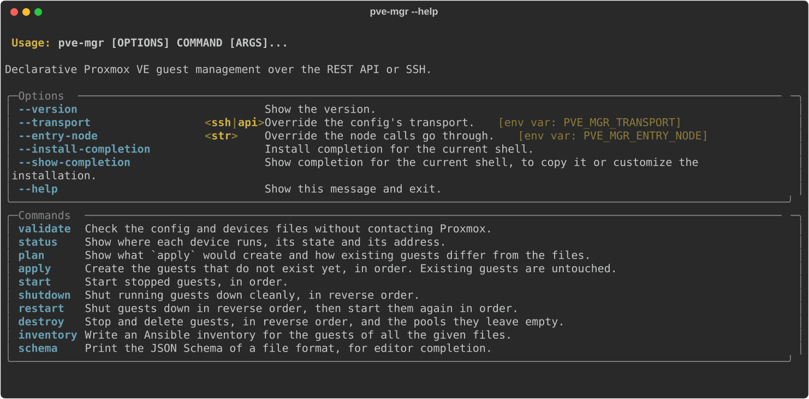
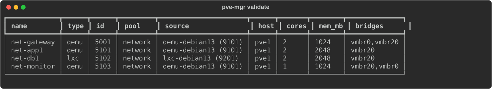

# pve-mgr

[](https://github.com/olexhm/pve-mgr-cli/actions/workflows/ci.yml)

This is a tool for resource provisioning on Proxmox, and for Ansible inventory generation. Is uses IaC-like definition of resources and provides for simpler and lighter management, than using OpenTofu/Terraform, or writing your own helper scripts. 

You describe the VMs and containers in a file. `pve-mgr` creates any that are missing from the specified template, in the specified order, waits for each to come online, and writes an Ansible inventory file with the correct jump hosts.

```yaml
# devices.yml
devices:
  - type: qemu
    id: 2001
    name: sandbox
    pool: sandbox
    template: qemu-debian13
    cores: 2
    memory_mb: 2048
    bridges: [vmbr0]
    ansible_user: ansible
```

```bash
pve-mgr plan devices.yml        # print what would be created
pve-mgr apply devices.yml       # create and wait until online
pve-mgr inventory devices.yml   # write inventory.ini
pve-mgr destroy devices.yml     # remove again
```

## Requirements

- Python 3.13+ and [uv](https://docs.astral.sh/uv/); `ssh` and `ssh-keygen` (required for SSH transport).
- A template for each type of virtual machine and container on the builder node. They will be cloned from there, and then migrated to the host node. For QEMU virtual machines, it is also possible to [install from an ISO](#iso).
- QEMU guest agent in QEMU templates, to provide the address.
- DHCP on the bridges (no static addressing).
- SSH: root (or a user with passwordless `sudo` for `pvesh`) key login on one node, or API: token (see [Transports](#transports)).

## Installation

```bash
uv tool install --editable .                                        # from a clone
uv tool install git+ssh://git@github.com/olexhm/pve-mgr-cli.git      # from git
```

Both install `pve-mgr` to `~/.local/bin` (run `uv tool update-shell` if it's not on `PATH`).

If installed in editable mode (from a clone): update by running `git pull`.

Else: update by running `uv tool install --reinstall .` or `uv tool upgrade pve-mgr`.

Uninstall: `uv tool uninstall pve-mgr`.

To run only in repo: `uv sync && uv run pve-mgr --help`.

Shell completion: `pve-mgr --install-completion`.

## Quick start

1. Test SSH without interaction (this also registers the host key, which is needed):

   ```bash
   ssh root@pve1 pvesh get /nodes --output-format json
   ```

2. Create `~/.config/pve-mgr/pve-mgr.yml`:

   ```yaml
   nodes:
     pve1: root@pve1        # Proxmox node name: SSH destination
   templates:
     qemu-debian13: 9101    # your name: template VMID
   ```

3. Create a devices file (like above), and then:

   ```bash
   pve-mgr validate devices.yml
   pve-mgr plan devices.yml
   pve-mgr apply devices.yml --dry-run
   pve-mgr apply devices.yml
   pve-mgr inventory devices.yml && ansible -i inventory.ini all -m ping
   ```

## Configuration file

Searched in order: `--config`/`-c` or `PVE_MGR_CONFIG`; `./pve-mgr.yml` (`.yaml`); `~/.config/pve-mgr/pve-mgr.yml` (`.yaml`).

```yaml
transport: ssh                # or: api
nodes:
  pve1:
    ssh: root@pve1
    api: https://pve1.example.com:8006
  pve2: root@pve2             # shorthand for {ssh: root@pve2}
entry_node: pve1
sudo: false
verify_tls: true
defaults:
  builder_node: pve1
  host_node: pve1
  disk_storage: local-lvm
  migration_storage: local-lvm
templates:
  qemu-debian13: 9101
  lxc-debian13: 9201
inventory: inventory.ini
known_hosts: ~/.ssh/known_hosts
```

| Key                          | Default                      | Description                                                  |
| ---------------------------- | ---------------------------- | ------------------------------------------------------------ |
| `transport`                  | `ssh`                        | `ssh` or `api`.                                              |
| `nodes`                      | required                     | Map of Proxmox node names (as in `pvesh get /nodes`) to their `ssh` target and/or `api` URL. |
| `entry_node`                 | `defaults.host_node`         | Node to talk to for every command.                           |
| `sudo`                       | on, unless target is `root@…` | Run `pvesh` via `sudo -n`.                                  |
| `verify_tls`                 | `true`                       | Set to `false` if the API has a self-signed certificate.     |
| `defaults.host_node`         | the only node                | The host node to put your guests on. (Required if you have more than one node.) |
| `defaults.builder_node`      | `defaults.host_node`         | The node to keep templates on and to clone on.               |
| `defaults.disk_storage`      |                              | Storage to keep `additional_disk`s and `iso.disk`s on.       |
| `defaults.migration_storage` | `defaults.disk_storage`      | Storage to migrate to when moving guests to the host node.   |
| `templates`                  | empty                        | A mapping of template names to VMIDs.                        |
| `inventory`                  | `inventory.ini`              | Output of `inventory`.                                       |
| `known_hosts`                | `~/.ssh/known_hosts`         | File from which `destroy` will delete host keys.             |

Any paths used are relative to the config file. Unknown keys are errors.

Only the entry node needs to specify the target of the transport. The rest should still be listed as node names for validation and for their `ssh` targets to be used as jump hosts in the inventory.

Specifying `--transport`/`PVE_MGR_TRANSPORT` or `--entry-node`/`PVE_MGR_ENTRY_NODE` takes precedence over the config:

```bash
pve-mgr --transport api --entry-node pve2 status devices.yml
```

## Devices files

A `devices:` key with a list of devices. Every command takes one or more of these files.

```yaml
devices:
  - type: qemu
    id: 1201
    name: lab-web1
    pool: lab
    template: qemu-debian13
    host_node: pve2
    cores: 2
    memory_mb: 2048
    bridges: [vmbr10]
    additional_disk:
      size: 50G
    ansible_user: ansible
```

| Key                 | Required | Description                                                  |
| ------------------- | -------- | ------------------------------------------------------------ |
| `type`              | yes      | `qemu` or `lxc`.                                             |
| `id`                | yes      | VMID, ≥ 100, unique over all devices files given together.   |
| `name`              | yes      | Hostname (letters, digits, `-`), unique.                     |
| `pool`              | yes      | Name of a resource pool. Will be created if it doesn't exist. |
| `template`          | one of   | Name in `templates`.                                         |
| `iso`               | one of   | For QEMU only. See [ISO](#iso).                              |
| `cores`             | yes      | Number of CPU cores.                                         |
| `memory_mb`         | yes      | Memory, in MiB.                                              |
| `bridges`           | yes      | A list of one or two bridges. The first one will be the primary network. |
| `ansible_user`      | yes      | Inventory user.                                              |
| `role`              | no       | If `gateway`, a second bridge is required. See [Gateways](#ordering-and-gateways). |
| `host_node`         | no       | If not specified, defaults to `defaults.host_node`.          |
| `builder_node`      | no       | If not specified, defaults to `defaults.builder_node`. (Not for `iso`.) |
| `migration_storage` | no       | If not specified, defaults to `defaults.migration_storage`.  |
| `additional_disk`   | no       | For QEMU only: a `size` is required, `storage` and `slot` default to `defaults.disk_storage` and `scsi1` respectively. See [Disk options](#disk-options). |
| `hardware`          | no       | For QEMU only. See [Hardware](#hardware).                    |
| `tags`              | no       | Guest tags (template tags will not be preserved). Lowercase letters, digits, `_ - + .`; starting with a letter, digit or `_`. |
| `ssh_port`          | no       | Defaults to 22.                                              |
| `proxy_jumps`       | no       | SSH jumps following the node, used instead of the gateway.   |

- Sizes are whole numbers: `50`, `50G`, `2T`.

### ISO

Creates an empty VM on its host node with a new disk and the image mounted in the CDROM device. Use `iso` rather than `template`:

```yaml
    iso:
      image: local:iso/debian-13-amd64-netinst.iso
      disk:
        size: 20G
```

| Key            | Required | Description                                                                                  |
|----------------|----------|----------------------------------------------------------------------------------------------|
| `iso.image`    | yes      | `<storage>:iso/<file>` on the host node.                                                     |
| `iso.disk`     | yes      | `size`, `storage` (default `defaults.disk_storage`), `bus`, [disk options](#disk-options).   |
| `iso.disk.bus` | no       | `scsi` (default), `virtio`, `sata`, `ide`. The disk is in slot 0, e.g. `scsi0`.              |
| `iso.tpm`      | no       | `v2.0` or `v1.2`, kept on the install disk's storage.                                        |

Defaults are `ostype: l26`, `bios: seabios`, `scsihw: virtio-scsi-single` (unless configured in `hardware`).

When using `bios: ovmf`, an EFI disk is also created on the same storage as the install disk. The boot order is disk, then CD, so the VM boots to the installer while the disk is empty. The image does not need to be unmounted because the system will continue to boot from the disk after installation.

With `apply`, the VM is started without waiting for it, since installation must be done manually. Use `--wait` and a longer `--timeout` for unattended images that install the guest agent. `plan` checks that the image exists, but does not compare the image or disk of existing VMs.

### Hardware

This is an optional configuration section for QEMU machine settings, applicable to both clones and ISO VMs. Unconfigured options are not modified – clones are left with what they got from the template, and ISO VMs receive the Proxmox default.

```yaml
    hardware:
      cpu: host
      bios: ovmf
      machine: q35
      onboot: true
      nic:
        model: virtio
        firewall: true
      options:
        hotplug: disk,network,usb
        serial0: socket
```

| Key           | Description                                                                                                                                        |
|---------------|----------------------------------------------------------------------------------------------------------------------------------------------------|
| `ostype`      | `l26`, `win11`, `other`, ...                                                                                                                       |
| `bios`        | `seabios` or `ovmf`. No EFI disk is created for clones.                                                                                            |
| `machine`     | `pc` or `q35`.                                                                                                                                     |
| `scsihw`      | e.g. `virtio-scsi-single`, `virtio-scsi-pci`.                                                                                                      |
| `cpu`         | e.g. `host`, `x86-64-v2-AES`.                                                                                                                      |
| `sockets`     | The total number of cores is calculated as `sockets` × `cores`.                                                                                    |
| `numa`        | Boolean.                                                                                                                                           |
| `cpu_limit`   | CPU time limit in cores, e.g. `1.5`; `0` means no limit.                                                                                           |
| `cpu_units`   | CPU weight.                                                                                                                                        |
| `balloon_mb`  | The minimum memory in MiB when ballooning; `0` disables ballooning.                                                                                |
| `vga`         | `std`, `cirrus`, `vmware`, `qxl`, `virtio`, `virtio-gl`, `serial0`, `none`.                                                                        |
| `onboot`      | Automatically starts the VM when the node boots.                                                                                                   |
| `startup`     | e.g. `order=2,up=30,down=60`.                                                                                                                      |
| `protection`  | Prevents deletion; `destroy` will fail.                                                                                                            |
| `tablet`      | Enables a USB tablet pointer.                                                                                                                      |
| `kvm`         | Enables hardware virtualization.                                                                                                                   |
| `description` | A note displayed in the Proxmox GUI.                                                                                                               |
| `nic`         | Affects each NIC defined by `bridges`:                                                                                                             |
|               | &nbsp; &nbsp; - `model` (default is `virtio`, other options: `e1000`, `e1000e`, `vmxnet3`, `rtl8139`)                                              |
|               | &nbsp; &nbsp; - `firewall` (default `false`)                                                                                                       |
|               | &nbsp; &nbsp; - `mtu` (applies to virtio interfaces only)                                                                                          |
| `options`     | Any additional settings passed through by name, exactly as shown by `qm config` and accepted by the [API](https://pve.proxmox.com/pve-docs/api-viewer/#/nodes/{node}/qemu/{vmid}/config). |

```yaml
      options:
        vcpus: 2
        hostpci0: 0000:01:00.0,pcie=1
        net2: virtio,bridge=vmbr30,tag=30
        ciuser: ansible      # template has to be cloud-init-ready
        ipconfig0: ip=dhcp
```

Note that only the key structure is validated. Incorrect settings will result
in `apply` errors. The following properties cannot be set in `options` as they
are managed by other means: `name`, `pool`, `cores`, `memory`, `tags`, `agent`,
`boot`, `net0`/`net1`, the `iso` and `additional_disk` disks, and any property
from the table above. `args` and `hookscript` require `root@pam`. Note that PCI
passthrough means that the clone can not be migrated to other nodes.

`plan` will show the Proxmox names (`cpulimit`, `balloon`) of properties that
differ on the guest. Multi-part values like `hotplug` are considered equal if
all parts you specified are present on the guest.

`hardware` does not cover VLAN tags and MACs on `bridges` NICs, resizing a
clone's disk, or containers.

### Disk options

These apply to `iso.disk` and `additional_disk`. If not specified, the
Proxmox default will be used.

| Key        | Meaning |
|------------|---------|
| `ssd`      | Marked as SSD. Only on non-virtio disks. |
| `discard`  | Passes the guest's TRIM on to the storage. |
| `iothread` | Gives the disk its own I/O thread. Only on `scsi` (with `virtio-scsi-single`) and `virtio`. |
| `cache`    | `none`, `writethrough`, `writeback`, `directsync`, `unsafe`. |

### Editor support

Any unknown property is considered an error. Export the JSON Schema to use
with an editor that supports code completion:

```bash
pve-mgr schema devices > devices.schema.json
pve-mgr schema config > pve-mgr.schema.json
```

```yaml
# yaml-language-server: $schema=./devices.schema.json
```

## Commands



Check `pve-mgr COMMAND --help` for available flags.

`apply`, `start`, `shutdown`, `restart` and `destroy` accept `--dry-run`,
which reads the cluster as usual and prints the changing API calls instead of
making them.

### plan

For each device the following will be reported:

* **create**: Will be created.
* **unchanged**: Device already exists and matches the file.
* **drift**: Device already exists but differs in name, type, node, pool,
  cores, memory, bridges, tags or extra disk.

`apply` does not correct drift. `plan` will also print error conditions that
would prevent `apply` from working (e.g. template not found on builder node,
ISO not found on host node).

### apply

```bash
pve-mgr apply devices.yml --timeout 600   # first boot can be slow
pve-mgr apply devices.yml --no-wait
```

For each missing guest, `apply` will:

1. Create the pool, if needed.
2. Full-clone the template on the builder node (or create an empty guest on the host node if `iso`).
3. Set cores, memory, NICs, tags, `hardware` and enable the QEMU agent.
4. Migrate to the host node.
5. Create the extra disk.
6. Start the guest.
7. Wait for the address (for `iso` guests only with `--wait`).

`apply` never touches existing guests, even stopped ones.

If a step fails, `apply` stops and reports what it has already done. The partial
guest will then appear in `plan` as drifted. Use `destroy` to remove it before
trying again.

### start, shutdown, restart

`start` will sequentially start all guests, waiting for each. `shutdown` will
sequentially shut down all guests in reverse order. Each guest is given
`--shutdown-timeout` seconds (default 180) to stop. After that it is
hard-stopped if `--force` is given; otherwise the command fails.

Missing guests are skipped.

### destroy

```bash
pve-mgr destroy devices.yml --yes    # skip the prompt
```

Destroys all guests and their disks from the bottom up, removes their host
keys from `known_hosts`, and then destroys the pools left empty.
Guests that don't match the type or name specified in the file, or are
templates, will not be destroyed.

Pools that have other members will not be destroyed.

## Ordering and gateways

Files are processed in the order they are provided on the command line,
and the devices in each file in the order written.
`apply` and `start` finish each guest, including waiting for its network
address, before moving on to the next one.
`shutdown` and `destroy` do the reverse.

If there's a VM that acts as the network gateway for the others, it must be
processed first:

```yaml
# gateway.yml
devices:
  - type: qemu
    id: 5001
    name: net-gateway
    pool: network
    template: qemu-debian13
    cores: 2
    memory_mb: 1024
    bridges: [vmbr0, vmbr20]   # uplink, served bridge
    role: gateway
    ansible_user: ansible
```

```bash
pve-mgr apply gateway.yml backend.yml
```

Note that just declaring `role: gateway` doesn't make this a router or DHCP
server.
It merely tells `inventory` that this VM should be used as a jump host for
guests that have `vmbr20` as their first bridge.

Only one guest can be defined as a gateway for any particular bridge.
Having multiple bridges without a `role` simply means that the guest has
multiple networks.

## Ansible inventory

The inventory will contain one line per running guest:

```ini
# Generated by pve-mgr inventory. Changes are overwritten on the next run.
net-gateway ansible_host=192.0.2.10 ansible_user=ansible ansible_port=22 ansible_ssh_common_args='-o StrictHostKeyChecking=accept-new -J root@pve1'
net-app1 ansible_host=198.51.100.21 ansible_user=ansible ansible_port=22 ansible_ssh_common_args='-o StrictHostKeyChecking=accept-new -J root@pve1,ansible@192.0.2.10'
```

The chain of jump hosts will be the node the guest is currently running on
(`nodes.<name>.ssh`, required with either transport) and then either
`proxy_jumps`, or the gateway of its first bridge. The IP address will be the
one in the first bridge's network if the node knows that network, otherwise
the first one reported.

The inventory is rewritten every time the command is run, so make sure
that all the files are passed at once.

Any missing or unaddressed guests will be ignored and reported on stderr.
If a gateway has no address, it is an error.

## Transports

Both use the same API calls; with SSH they run as `pvesh` on the node.

**SSH** will use your `ssh`, so it will respect `~/.ssh/config`, agents and
jump hosts, and will reuse one connection.
It runs non-interactively, so there can't be any passphrase prompts
(use an agent), the host key must already be in `known_hosts`, and if running
as a non-root user you must configure `sudo` to be passwordless for `pvesh`.

**API**:

```yaml
transport: api
nodes:
  pve1:
    api: https://pve1.example.com:8006
```

Create an API token and export it

```bash
export PVE_MGR_API_TOKEN_ID='automation@pve!pve-mgr'
export PVE_MGR_API_TOKEN_SECRET='00000000-0000-0000-0000-000000000000'
```

The token will need cluster reading, VM cloning and configuration, storage
and bridge access, and pool management permissions.
If you're using privilege separation, grant the permissions to the token itself.

The minimal set is unknown, but `PVEAdmin` on `/` is a starting point.

| Variable                   | Meaning |
|----------------------------|---------|
| `PVE_MGR_CONFIG`           | Config file path. |
| `PVE_MGR_TRANSPORT`        | `ssh` or `api`. |
| `PVE_MGR_ENTRY_NODE`       | Entry node. |
| `PVE_MGR_API_TOKEN_ID`     | `user@realm!name`. |
| `PVE_MGR_API_TOKEN_SECRET` | Token secret. |

## Examples

[`examples/`](examples) are tested and contain placeholder names.

| Files | Shows |
|-------|-------|
| [`minimal/`](examples/minimal) | A minimal setup with a single VM. |
| [`pve-mgr.yml`](examples/pve-mgr.yml) | A 2-node config that the following files use. |
| [`devices.yml`](examples/devices.yml) | Includes a gateway, a VM on another node with an additional disk, and a container with jump hosts. |
| [`swarm.yml`](examples/swarm.yml) | Swarm of VMs across two nodes, with data disks. |
| [`containers.yml`](examples/containers.yml) | Contains only LXC containers. |
| [`iso.yml`](examples/iso.yml) | ISO installs, including one with UEFI, TPM and `hardware`. |
| [`network/`](examples/network) | A gateway, followed by guests behind it. |
| [`api/`](examples/api) | An API transport configuration and `.env.example`. |

```bash
pve-mgr validate -c examples/minimal/pve-mgr.yml examples/minimal/devices.yml
pve-mgr validate -c examples/pve-mgr.yml examples/network/gateway.yml examples/network/backend.yml
```



## Development

```bash
uv sync
uv run pre-commit install     # runs the checks below on commit
uv run pytest
uv run ruff check --fix && uv run ruff format
uv run ty check
```

Regenerate the images in `docs/` after changing the CLI output:

```bash
uv run python scripts/term_svg.py docs/help.svg "pve-mgr --help" uv run pve-mgr --help
uv run python scripts/term_svg.py docs/validate.svg "pve-mgr validate" \
  uv run pve-mgr validate -c examples/pve-mgr.yml examples/network/gateway.yml examples/network/backend.yml
```

## License

[MIT](LICENSE)
